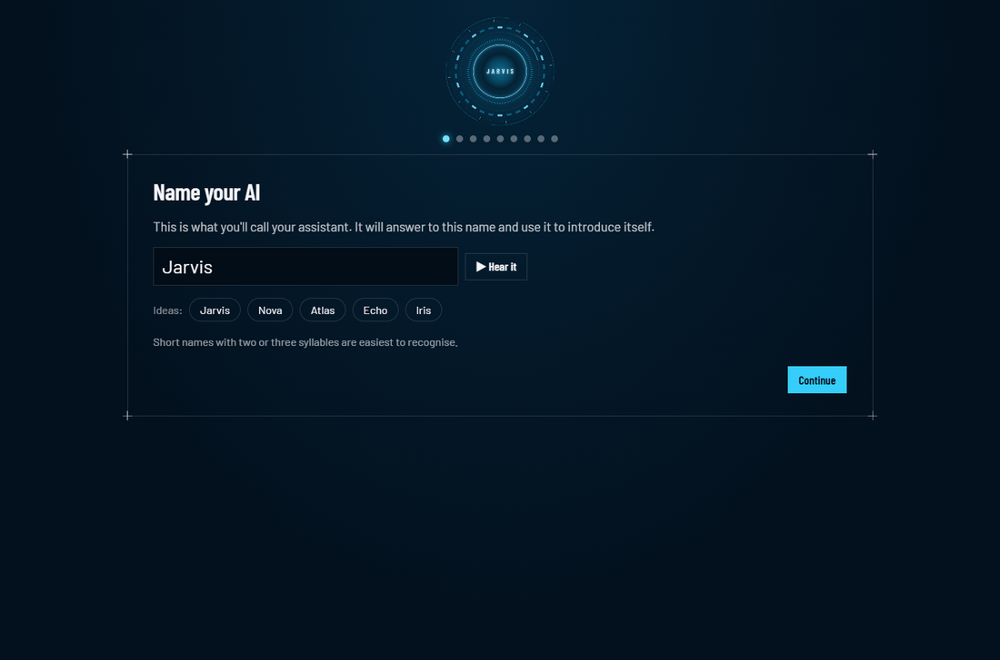
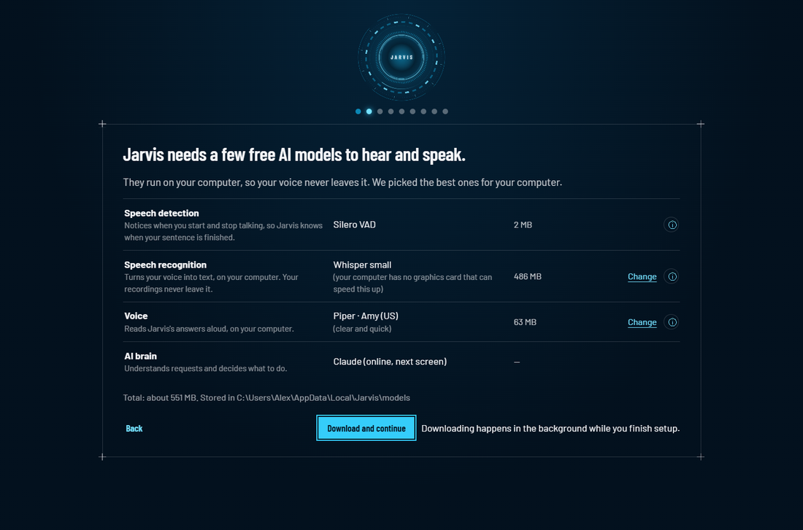
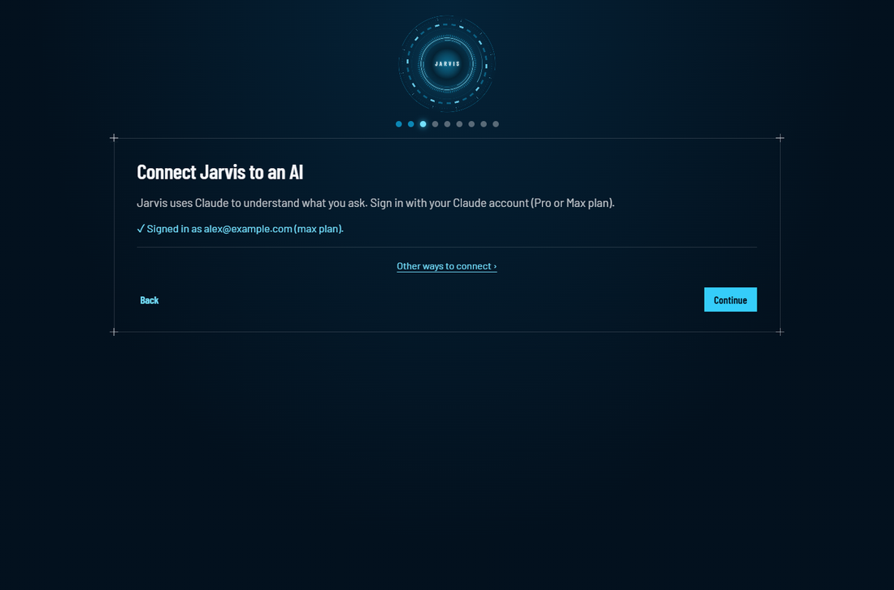
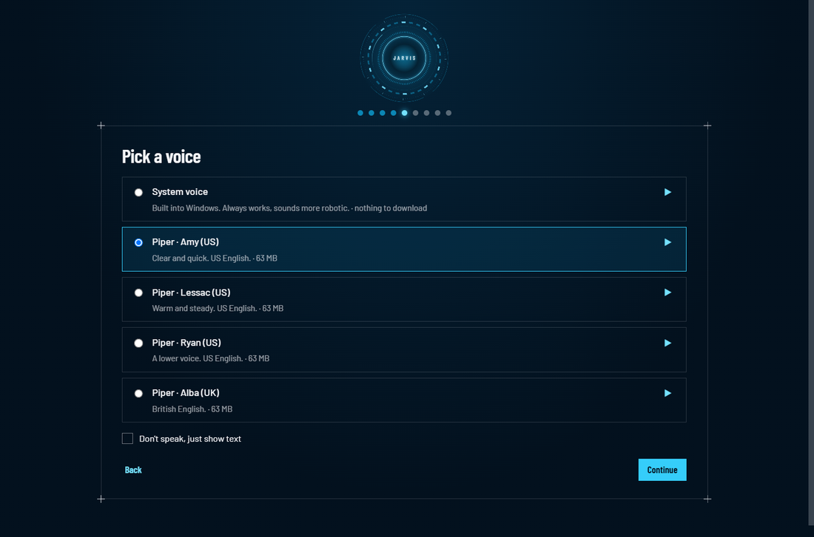
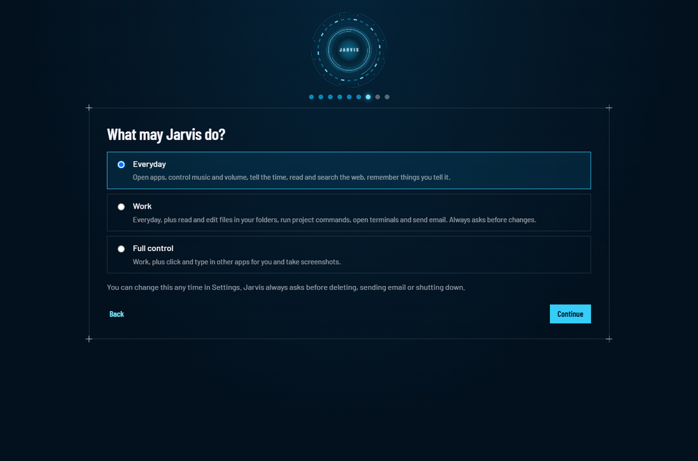
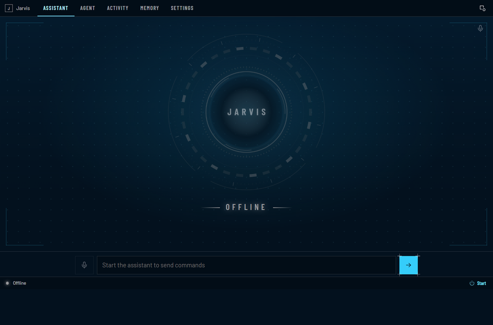
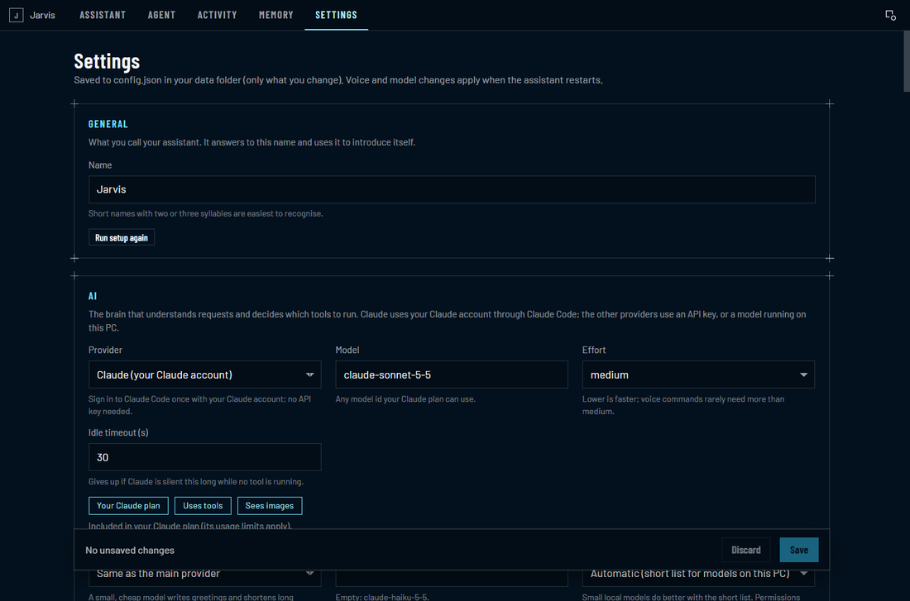

# Getting started with Jarvis

Jarvis is an assistant you talk to. Ask it to open apps, play music, look things up, find files and more. It
always asks before doing anything important.

This guide takes about 5 minutes. You don't need any technical knowledge once Jarvis is installed.

**You need:** a Windows 11 PC or a Mac with Apple silicon (M1 or later, macOS 13 or later), a microphone (most
laptops have one; without one you can type), an internet connection, and a **Claude Pro or Max** plan (sign up
at claude.ai). No Claude plan? See
[Other ways to connect](#5-other-ways-to-connect).

> Jarvis isn't released yet. Until the first download is published, it runs from its source code: see
> [Running from source](../README.md#running-from-source). The setup steps below are the same either way.

---

## 1. Install

1. Download Jarvis for Windows from the website (an .exe file).
2. Open it from your **Downloads** folder.
3. Click **Install**. Jarvis installs for you only and needs no administrator password.
4. If Windows says "Windows protected your PC", click **More info**, then **Run anyway**. Jarvis is free and
   isn't code-signed, so Windows asks this once.

The setup wizard opens. On its last screen, **Install for me** moves Jarvis out of your Downloads folder and adds
it to the Start Menu.

**On a Mac:**
1. Download Jarvis for Mac (a .dmg file) and open it. Drag **Jarvis** onto the **Applications** folder in the
   window that opens.
2. Open **Jarvis** from Applications. The first time, macOS says it can't check it, because Jarvis isn't notarized by
   Apple: click **Done**, open **System Settings › Privacy & Security**, scroll down and click **Open Anyway**,
   then **Open**. macOS asks this once.
3. When the setup wizard reaches the microphone, click **Allow** so macOS lets Jarvis hear you.

If you opened Jarvis straight from the disk image, **Install for me** on its last screen copies it into your
Applications folder, where it can update itself.

## 2. Set up (the setup wizard)

When Jarvis opens for the first time, a short setup guides you. Just follow the big button on each screen.
**Back** takes you to the previous screen, and if you close Jarvis halfway it continues where you stopped.

1. **Name your AI**: choose a name for your assistant (or keep the suggestion) and press **▶ Hear it**. Your
   assistant answers to this name from now on; below, we call it Jarvis.

   

2. **What Jarvis needs**: Jarvis shows the free AI models it will download and what each one does. It has
   already picked the best ones for your computer, so just click **Download and continue**. Click **Change**
   to pick another one, or **ⓘ** to learn more and see the official page and license.

   

3. **Connect your AI**: click **Sign in with Claude**. Your web browser opens. Sign in with **Google** or your
   email, then go back to Jarvis; it shows a tick with your account. If Claude Code (Anthropic's app that
   Jarvis uses for this) isn't on your computer yet, click **Install it for me** first.

   

4. **Microphone**: pick your microphone if it isn't already chosen, click **Test** and say "Hello Jarvis".
   The bar shows your voice level. If Windows blocks the microphone, click **Open privacy settings**.
5. **Voice**: press **▶** to hear the voices and pick the one you like. Tick **Don't speak, just show text** if
   you prefer reading.

   

6. **About you** (optional): tell Jarvis your name, and add folders it may work in. You can click **Skip**.
7. **What Jarvis may do**: keep **Everyday** if you're unsure. You can change this later.

   

8. **Start-up**: choose whether Jarvis starts when you sign in to Windows.
9. **Try it**: click **Talk** and say **"What time is it?"**, or type it. Then click **Finish**.

While you do this, Jarvis downloads its models in the background (about 550 MB on most computers); a bar at
the bottom shows the progress. If they're still downloading at the end, you can type to Jarvis until they're
ready.

### What gets downloaded

All of these are free and run on your own computer. You can change them later in **Settings › Models**.

| What | What it does | Default | Size | Official page |
|---|---|---|---|---|
| Speech detection | Notices when you start and stop talking | Silero VAD | 2 MB | https://github.com/snakers4/silero-vad |
| Speech recognition | Turns your voice into text | Whisper *small* (*medium* with an NVIDIA graphics card and its CUDA libraries) | 486 MB (1.5 GB) | https://huggingface.co/Systran/faster-whisper-small |
| Voice | Reads answers aloud | Kokoro · Heart (one download holds all the Kokoro voices) | 354 MB, plus about 25 MB for the Kokoro engine | https://huggingface.co/hexgrad/Kokoro-82M |

**Slow or no internet at setup?** Click **ⓘ** on a row › **Download manually**: your browser downloads the
file. Then click **I already have this file** and pick it. Jarvis checks the file is the right one before using
it. Downloads that stop halfway continue where they stopped.

Until the voice has downloaded, Jarvis speaks with the voice built into Windows. You can also keep that one: it
needs no download, but sounds more robotic.

The Kokoro voices need the Kokoro engine. It uses espeak-ng and phonemizer, which are open source under the
GPL-3.0 license, so the engine is not part of Jarvis. Jarvis installs it from the Python Package Index together
with the voice (this part needs internet; it can't be downloaded by hand in the browser). Piper voices work the
same way.

## 3. Everyday use

- **Talk:** click the orb, or press **Ctrl+Shift+J** (on a Mac **Control-Shift-J**, ⌃⇧J), then speak. Jarvis
  stops listening when you stop talking.
- **Hold to talk:** in the Jarvis window, hold **Space** while you speak.
- **Type:** write in the box under the orb and press Enter.
- **Mute the microphone:** **Ctrl+M** or the microphone button.
- **Approve or refuse:** when Jarvis wants to do something important, it shows a box and asks out loud. Click
  **Allow** or **Deny**, press **Y** or **N**, or say "yes" / "no".
- **Hide it:** close the window. Jarvis keeps running as a small orb and an icon in the taskbar tray (in the
  menu bar on a Mac). Right-click the icon to quit (on a Mac, click it).

Things to try:
- "Open Notepad" / "Open Chrome"
- "Play the next song" / "Turn the volume down"
- "What's the weather in Chennai?"
- "Remember that my passport is in the blue drawer" … later: "Where is my passport?"
- "Summarize this web page: <link>"

## 4. Change what Jarvis is allowed to do

Open **Settings › Tools and permissions**, or run the setup again (**Settings › General › Run setup again**)
and pick another card:

- **Everyday**: apps, music and volume, time, web, memory, reading the folders you added, locking the PC.
- **Work**: also edits files in those folders, runs project commands, opens Command Prompts (Terminal windows on
  a Mac), sends email and runs coding agents. Asks before risky changes.
- **Full control**: also looks at, clicks and types in other apps for you and takes screenshots. On a Mac, this
  needs two permissions in System Settings › Privacy & Security, **Accessibility** and **Screen & System Audio
  Recording**: the setup wizard shows both, with buttons that open the right page.

In **Settings › Tools and permissions** you can also switch each group on or off by itself.

Jarvis **always** asks before deleting a file, emailing someone who isn't on your trusted list, shutting down
or restarting your computer, or typing into a running program. For these, click **Allow** or press **Y**: a
spoken "yes" isn't enough. After it reads a web page or a screen, it also asks before any change. The details
are in [What Jarvis can do on your PC, and how to limit it](SECURITY_MODEL.md).

## 5. Other ways to connect

In the setup (or **Settings › AI**), click **Other ways to connect**:

- **Claude API key**: pay per use instead of a plan. Create a key in the Anthropic Console and paste it.
- **Free and private**: runs an AI model on your own computer with Ollama or LM Studio. Needs a powerful
  computer (16 GB of memory or more).
- **Other providers**: OpenAI, Google Gemini, OpenRouter, Groq and others with an API key.

Details: [AI providers](PROVIDERS.md).

## 6. Something's not working?

When something goes wrong, Jarvis shows a bar at the top of its window that says what happened, with a button
that fixes it.

| Problem | What to do |
|---|---|
| Jarvis doesn't hear me | **Settings › Microphone**: check the microphone. If the bar says access is blocked, click **Open privacy settings** and turn microphone access on (on a Mac: **System Settings › Privacy & Security › Microphone › Jarvis**) |
| Mac: "Jarvis can't be opened" | **System Settings › Privacy & Security**, then **Open Anyway** (see step 1) |
| "Speech recognition isn't downloaded yet" | Click **Open Models** and download it, or wait for the download to finish |
| "You're signed out of Claude" | Click **Sign in** and sign in again in the browser |
| "Claude's usage limit is reached" | Your plan's limit resets at the time shown. You can add an API key meanwhile (**Use an API key instead**) |
| "This API key didn't work" | Click **Change key** and paste a new one |
| Voice sounds robotic or slow | **Settings › Models** or **Settings › Voice**: pick another voice |
| Anything else | **Settings › Logging and diagnostics › Save a report**, then attach the file when you report the problem. The report never contains your passwords or keys, and your user folder and email addresses are hidden |

## 7. Update and uninstall

- **Updates:** Jarvis checks when it starts and downloads a new version in the background. When it's ready, a
  bar says so: click **Restart to update**. **Settings › About › Check for updates** checks now.
- **Uninstall:** **Settings › About › Uninstall**. Tick the box first if you also want your settings,
  memories, downloaded models and saved keys deleted.

## Privacy in one paragraph

Listening only starts when you click or press the shortcut. Speech is turned into text on your computer. Only the
text of your request (and, with Full control, screenshots you allow) is sent to the AI you connected. Your history
and memories stay on your computer. Jarvis has no ads, no tracking and no telemetry.
